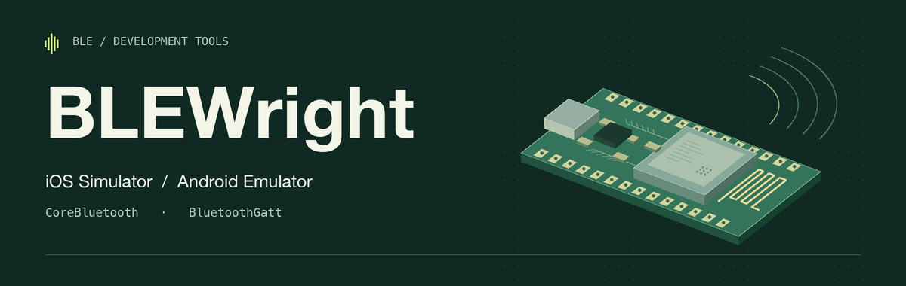
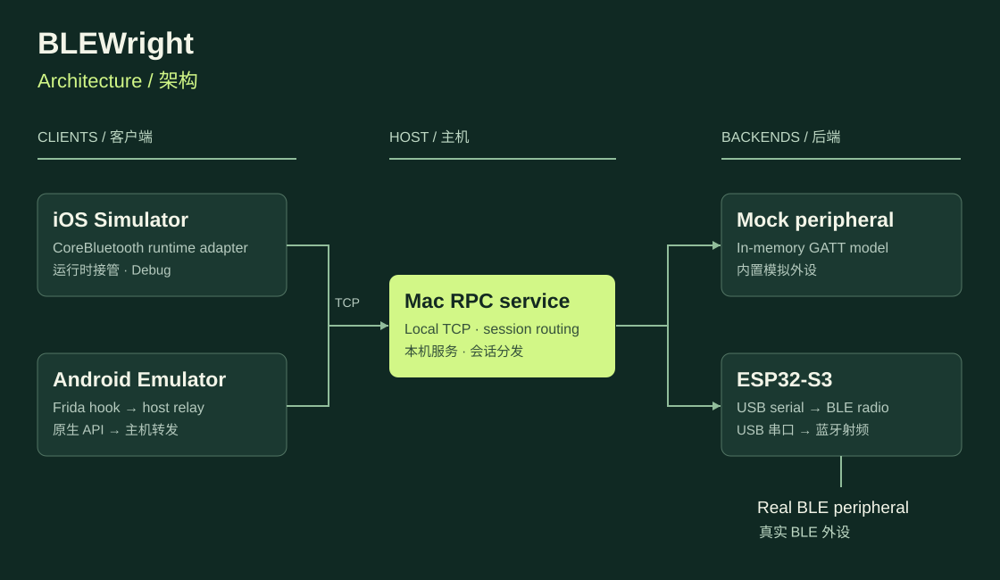

[English](README.md) · [简体中文](README.zh-CN.md)

# BLEWright



Run the BLE central code in your mobile app against a simulated peripheral or a device on your desk. Your app scans, connects, discovers services and receives notifications through its usual platform APIs. A local service supplies the BLE backend. Plug an ESP32-S3 into your Mac when you need a real radio.

## Try a scan

With Git and Node.js 20 or newer, run:

```sh
git clone https://github.com/openingax/BLEWright-Community.git
cd BLEWright-Community
node examples/mock-scan.mjs
```

The example starts a temporary loopback server, discovers the built-in fixture and exits. It needs no board, emulator or npm install. Expected output:

```text
Found BLEWright  02:00:00:00:00:01  -48 dBm (mock)
```

## Connect your app

| Starting point | How it connects | What you need |
| --- | --- | --- |
| iOS Simulator | SimulatorBLE adapts CoreBluetooth calls to the local service | Xcode, a simulator-compatible app and SDKs, opt-in Debug scheme |
| Android Emulator | The developer launcher attaches the BLE adapter and relays events | Supported development emulator, ADB and matching Frida tools |
| Physical BLE peripheral | Mac service communicates with a USB-connected ESP32-S3 | Data-capable USB cable, bridge firmware and an advertising peripheral |

For the first app run, start the mock service with `npm run serve`. Set the iOS Debug scheme or Android launcher to port **8765**. For real hardware, start the ESP32 backend and use port **8876**. An App Store or device build uses the native iOS Bluetooth stack.

**[Follow the setup guide →](docs/guide.en.md)** · [中文接入指南](docs/guide.zh.md)

## How it works



The mock has one device named `BLEWright`, service `FFF0` and characteristic `FFF1`. Use it to step through discovery and reproduce reads, writes and notification callbacks. With the hardware backend, advertisements and GATT data come from the physical peripheral. The bridge negotiates ATT MTU; the usable write size depends on the result. One hardware connection is supported at a time.

## Compatibility

The development team exercised iOS simulator scanning and GATT, including provisioning a Wi-Fi fan over an ESP32-S3, and Android API 35 arm64 emulator scanning and GATT. Provisioning depends on the peripheral, its SDK and its network service. The runtime adapters cover a subset of the native APIs. Pairing/bonding, background restoration, BLE peripheral role and Bluetooth Classic are outside the current hardware path. The iOS adapter requires simulator-compatible dependencies and activates automatically only in opted-in Debug simulator runs.

## Develop and share

```sh
npm ci
npm run build
npm test
npm run check:ios-protocol
```

See the [contributor notes](CONTRIBUTING.md) for reporting a reproducible issue and the [RPC contract](protocol/README.md) for protocol details. Download the [English share card](docs/assets/social-en.png) or [Chinese share card](docs/assets/social-zh.png).

BLEWright is available under the [MIT License](LICENSE). The iOS runtime adapter includes [third-party acknowledgments](ios/NOTICE.md).
