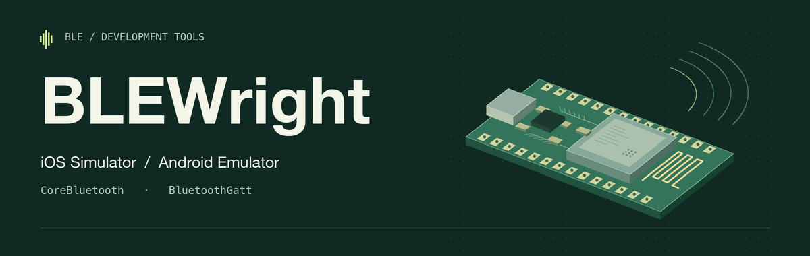
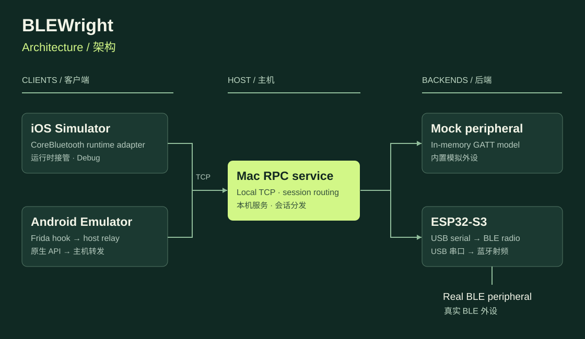

[English](README.md) · [简体中文](README.zh-CN.md)

# BLEWright



在 iOS 模拟器或 Android 模拟器里，直接调试 App 现有的低功耗蓝牙（BLE）代码。扫描、连接、发现服务、收发数据继续走平台原有的 API。你可以先用内置虚拟外设验证流程，再把 ESP32-S3 用 USB 接到 Mac，与桌上的真实设备通信。

## 第一次扫描

准备好 Git 和 Node.js 20 或更新版本，执行以下命令。

```sh
git clone https://github.com/openingax/BLEWright-Community.git
cd BLEWright-Community
node examples/mock-scan.mjs
```

示例会启动一个临时本地服务，扫描到内置设备后自动退出。无需安装 npm 依赖、启动模拟器或插开发板。预期输出如下。

```text
Found BLEWright  02:00:00:00:00:01  -48 dBm (mock)
```

## 接入自己的 App

| 使用场景 | 接入方式 | 需要准备 |
| --- | --- | --- |
| iOS 模拟器 | SimulatorBLE 把 CoreBluetooth 调用转给本地服务 | Xcode、可运行在模拟器上的 App 和 SDK、启用桥接的 Debug scheme |
| Android 模拟器 | 开发启动器接入 BLE 适配层并转发事件 | 受支持的开发模拟器、ADB 和版本匹配的 Frida 工具 |
| 调试真实 BLE 外设 | Mac 服务通过 USB 使用 ESP32-S3 的蓝牙 | 能传数据的 USB 线、刷有桥接固件的开发板、正在广播的外设 |

第一次接 App 时，运行 `npm run serve` 启动虚拟外设服务，把 iOS scheme 或 Android 启动器的端口设为 **8765**。切换到真实外设时，启动 ESP32 后端，端口改为 **8876**。iOS 真机和上架版本继续使用系统 CoreBluetooth。

**[查看完整接入指南 →](docs/guide.zh.md)** · [English setup guide](docs/guide.en.md)

## 架构



内置外设名为 `BLEWright`，服务 UUID 为 `FFF0`，特征 UUID 为 `FFF1`。可用它单步调试发现服务、读写和通知回调。硬件模式下，广播和 GATT 数据来自真实外设。写入长度取决于实际协商的 ATT MTU，硬件后端同时支持一条连接。

## 已验证范围

开发过程中已实测 iOS 模拟器的扫描和 GATT 通信，包括通过 ESP32-S3 给一款 Wi-Fi 风扇配网。Android 端已实测 API 35 arm64 模拟器扫描及 GATT 通信。其他设备的配网结果还取决于设备协议、厂商 SDK 与网络服务。当前硬件链路支持的范围不含配对绑定、后台恢复、BLE 外设角色和经典蓝牙。iOS SDK 本身需要包含模拟器架构，桥接只在显式启用的 Debug 模拟器运行中自动生效。

## 开发与分享

```sh
npm ci
npm run build
npm test
npm run check:ios-protocol
```

提交问题前可参考[贡献说明](CONTRIBUTING.md)，协议实现见 [RPC 约定](protocol/README.md)。分享项目时可下载[中文宣传图](docs/assets/social-zh.png)或[英文宣传图](docs/assets/social-en.png)。

项目采用 [MIT 许可证](LICENSE)。iOS 运行时适配层的第三方来源见[致谢](ios/NOTICE.md)。
